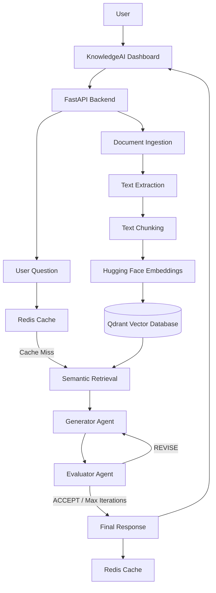

# 🧠 KnowledgeAI
### Agentic RAG Platform with Generator–Evaluator Architecture

KnowledgeAI is an AI-powered knowledge management platform that allows users to upload documents, build a searchable knowledge base, and ask questions about their content.

It uses a **Retrieval-Augmented Generation (RAG)** pipeline combined with a **Generator–Evaluator architecture** to produce context-aware answers and iteratively evaluate their quality, relevance, and grounding in retrieved sources.

---

## 🚀 Key Features

- **Multi-format Document Ingestion:** Extract knowledge from PDF, DOCX, TXT, Markdown, PowerPoint, and source code files.
- **Web Knowledge Ingestion:** Support for web pages and Wikipedia content.
- **Audio Transcription:** Convert WAV audio files into text using Faster-Whisper.
- **Semantic Search:** Retrieve relevant document chunks using Hugging Face embeddings and Qdrant.
- **Generator Agent:** Generate answers based on retrieved knowledge.
- **Evaluator Agent:** Evaluate generated answers for relevance, accuracy, completeness, and grounding.
- **Iterative Improvement:** Allow the Generator to revise its answer based on Evaluator feedback, with a maximum of four iterations.
- **Redis Caching:** Cache responses to improve performance and reduce repeated LLM calls.
- **Separate Agent Memories:** Maintain separate conversation histories for Generator and Evaluator.
- **REST API:** Expose backend functionality through FastAPI.
- **Interactive Dashboard:** A web-based interface for document management and AI-powered question answering.

---

## 🏗️ System Architecture

KnowledgeAI follows a modular architecture consisting of document ingestion, retrieval, generation, evaluation, and response delivery.



### Generator–Evaluator Workflow

1. The user submits a question.
2. The system checks Redis for a cached response.
3. If no cached response exists, relevant document chunks are retrieved from Qdrant.
4. The Generator creates an answer using the retrieved context.
5. The Evaluator reviews the generated answer.
6. If the answer needs improvement, feedback is sent back to the Generator.
7. The process continues until the answer is accepted or the maximum iteration limit is reached.
8. The final response is returned and cached.

---

## 🛠️ Tech Stack

| Component | Technology |
|---|---|
| Backend | Python, FastAPI |
| Frontend | HTML, CSS, JavaScript |
| LLM Provider | OpenRouter |
| Vector Database | Qdrant |
| Embedding Model | sentence-transformers/all-MiniLM-L6-v2 |
| LLM Orchestration | LangChain, LCEL |
| Cache | Redis / Memurai |
| Audio Transcription | Faster-Whisper |
| Document Processing | PyPDF, python-docx, python-pptx |
| Web Processing | BeautifulSoup, Wikipedia |
| Environment Management | Python venv |

---

## 📂 Project Structure

```text
Knowledge_Ai/
│
├── frontend/
│   ├── index.html
│   ├── style.css
│   └── script.js
│
├── uploaded_files/
├── qdrant_data/
│
├── config.py
├── ingestion.py
├── agents.py
├── work_flow.py
├── main.py
│
├── .env
├── .gitignore
├── requirements.txt
└── README.md
```

---

## ⚙️ Installation & Setup

### 1. Clone the Repository

```bash
git clone https://github.com/YOUR_USERNAME/KnowledgeAI.git
cd KnowledgeAI
```

### 2. Create a Virtual Environment

```bash
python -m venv .venv
```

Activate it on Windows:

```powershell
.venv\Scripts\activate
```

### 3. Install Dependencies

```bash
python -m pip install -r requirements.txt
```

### 4. Configure Environment Variables

Create a `.env` file in the project root:

```env
OPENROUTER_API_KEY=your_openrouter_api_key
OPENROUTER_MODEL=your_model_id

REDIS_URL=redis://localhost:6379/0
REDIS_TTL=3600
```

**Important:** Never upload your `.env` file or expose your API keys publicly.

### 5. Start Redis

Make sure your local Redis-compatible service (such as Memurai on Windows) is running.

Test the connection:

```bash
redis-cli ping
```

Expected output:

```text
PONG
```

### 6. Run the Application

```bash
python -m uvicorn main:app --reload
```

The application will be available at:

- **Dashboard:** http://127.0.0.1:8000/
- **API Documentation:** http://127.0.0.1:8000/docs
- **Health Check:** http://127.0.0.1:8000/health

---

## 🔌 API Endpoints

| Method | Endpoint | Description |
|---|---|---|
| GET | `/` | Serve the dashboard |
| GET | `/health` | Check application health |
| POST | `/upload` | Upload and index a document |
| GET | `/documents` | List uploaded documents |
| DELETE | `/documents/{filename}` | Delete a document and its chunks |
| POST | `/ask` | Ask questions about the knowledge base |

### Example: Ask a Question

**POST** `/ask`

Request:

```json
{
  "question": "What are Large Language Models?"
}
```

The API returns the generated answer, evaluation status, iteration count, and evaluation details.

---

## 🧠 Core AI Concepts

KnowledgeAI combines several important AI engineering concepts:

- Retrieval-Augmented Generation (RAG)
- Vector Embeddings and Semantic Search
- Large Language Models (LLMs)
- Agentic Workflows
- Generator–Evaluator Architecture
- Iterative Self-Refinement
- Conversational Memory
- Semantic Caching
- LangChain Expression Language (LCEL)

---

## 🔮 Future Improvements

- Source citations with page-level references.
- Streaming responses for faster user experience.
- Advanced document preview.
- Conversation history and session management.
- Improved evaluation metrics and scoring.
- Support for additional audio and document formats.
- Authentication and multi-user workspaces.
- More advanced agentic workflows.

---

## 👨‍💻 Author

**Ahmed Badawy**

AI & Machine Learning Engineer | Data Science

- GitHub: [A7medBadwy](https://github.com/A7medBadwy)
- LinkedIn: [Ahmed Badawy](https://www.linkedin.com/in/ahmedbadawy5/)

---

## 📄 License

This project is developed for educational and AI engineering purposes.

